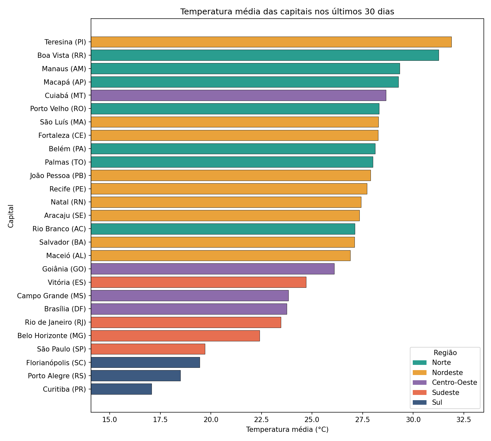
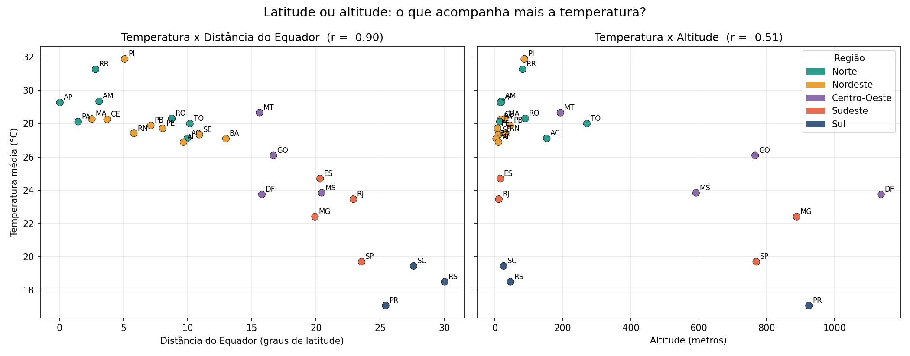

# 🌡️ Clima nas 27 capitais brasileiras: latitude ou altitude?

Projeto prático de **coleta de dados** da disciplina D1INT (Introdução à Ciência de Dados), Prof. Danilo Pereira.
Autora: **Ingrid dos Santos Cutrim**

## Pergunta
O que acompanha mais a temperatura média das capitais brasileiras: a **distância do Equador** (latitude) ou a **altitude**?

## Fontes de dados (todas via API, gratuitas e sem chave)
| Fonte | Método | O que fornece |
|---|---|---|
| [IBGE, API de Localidades](https://servicodados.ibge.gov.br/api/docs/localidades) | API REST | Estado e região de cada UF |
| [Open-Meteo Geocoding](https://open-meteo.com/en/docs/geocoding-api) | API REST | Latitude, longitude, altitude e população |
| [Open-Meteo Forecast](https://open-meteo.com/en/docs) | API REST | Temperatura, chuva e umidade diárias dos últimos 30 dias |

## Como executar
1. Abra o notebook `Projeto_Coleta_Clima_Capitais.ipynb` no Google Colab ou no Jupyter.
2. Clique em **Ambiente de execução → Executar tudo**. A coleta leva cerca de 1 minuto.
3. Bibliotecas usadas: `requests`, `pandas` e `matplotlib` (já vêm instaladas no Colab).

## Arquivos
| Arquivo | Conteúdo |
|---|---|
| `Projeto_Coleta_Clima_Capitais.ipynb` | Código completo e documentação |
| `dataset_clima_capitais.csv` | Dataset final: 1 linha por capital (27 linhas × 20 colunas) |
| `dataset_clima_diario.csv` | Registros diários limpos (≈ 810 linhas) |
| `documentacao.md` | Documentação gerada automaticamente, com os insights |
| `dados_brutos/` | Respostas originais das APIs em JSON |
| `graficos/` | Gráficos em PNG |

## Pipeline
`coleta (3 APIs)` → `salvar bruto` → `limpeza` → `agregação por capital` → `merge das fontes` → `análise` → `gráficos` → `CSV + documentação`

## Principais resultados

1. A capital mais quente no período foi Teresina-PI (31.9 °C) e a mais fria foi Curitiba-PR (17.1 °C): diferença de 14.8 °C.
2. A região com maior temperatura média foi a Norte (28.8 °C).
3. A correlação entre altitude e temperatura foi moderada e negativa (r = -0.51); entre distância do Equador e temperatura foi forte e negativa (r = -0.90). Neste período, a distância do Equador acompanhou melhor a variação de temperatura.
4. Rio Branco-AC foi a capital mais chuvosa (251 mm em 30 dias).
5. A maior amplitude térmica (diferença média entre máxima e mínima) foi em Teresina-PI: 13.3 °C.

## Limitações
- Período de 30 dias (reflete a estação atual, não o ano todo).
- Dados de modelos meteorológicos, não de estações oficiais.
- Correlação não indica causa.
